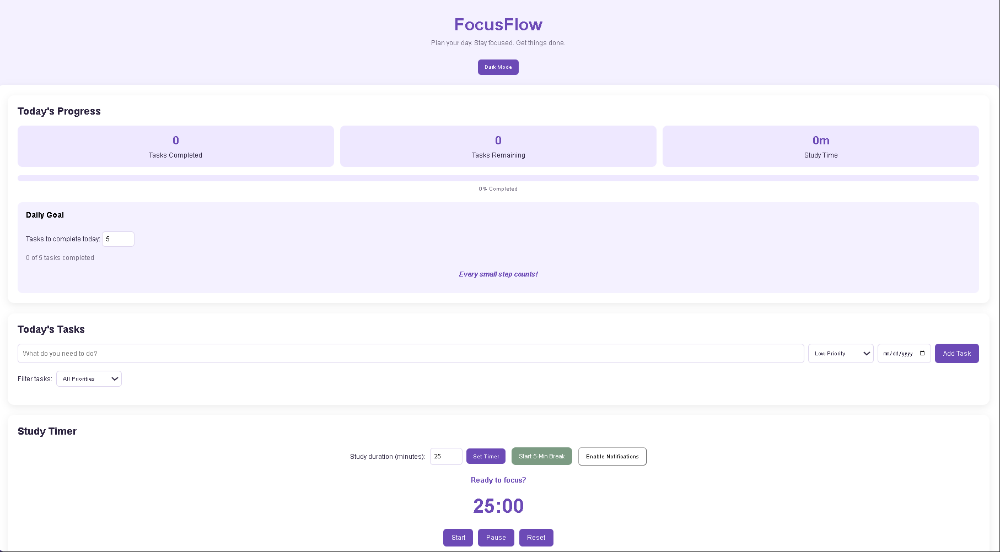

# Focus-Flow
FocusFlow is a productivity web app designed to help students organize their tasks and manage their time.
Users can create and prioritize tasks, track deadlines, monitor their progress toward daily goals, and use a study timer with break reminders. Focusflow also includes saved task data, study-time tracking, browser notifications, and dark mode.

https://focusflow-blush-one.vercel.app/

Features
Tasks: add tasks with a priority (low, medium, high) and due date, mark tasks complete and delete them.
Filtering: show all tasks or only a certain priority level.
Due date highlighting: overdue tasks and tasks due today are highlighted.
Study timer: custom study duration(1-180 minutes), pause and resume, and a 5-minute break timer.
Study timer tracking: total study time for the day, which resets each morning.
Daily goal: set how many tasks  you want to finish today and track progress with a progress bar and motivaional messages.
Dark mode: toggle between light and dark themes.
Saved data: tasks, goal, theme, and study time are stored in your browser with localStorage, so they are still there when user comes back.
Notifications: a browser notification and sound when a session or break ends.

Built with HTML, CSS, and JavaScript

Project Structure
index.html - Contains app's HTML structure.
style.css - Contains app's styling.
script.js - Handles task management, timer, and interactive features.

What I learned:
localStorage
working with browser APIs
making a responsive layout with a dark mode theme

Future improvements:
Edit existing tasks
Sort tasks by due date
Weekly study statistics
Drag and drop to reorder tasks

Made by [Esther Shodeinde](https://github.com/esther314)
